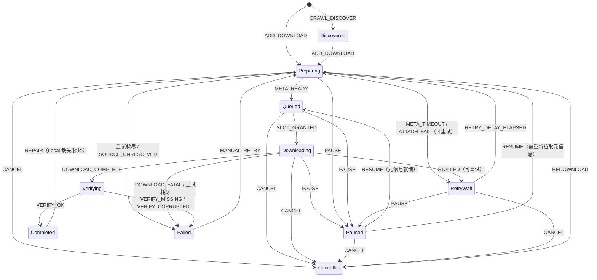

# 资源状态机设计方案

> 适用范围：种子资源页（Resources）、下载页（Download）、播放页（Video）、应用启动恢复、系统设置（下载目录）。
> 目标：用一个可证明正确的双轴状态机替换现有 `LocalStatus` + `DownloadStatus` 组合，消除非法组合、死锁与不可达状态，并保证状态查询与流转判定 O(1)。

## 1. 页面业务节点全景

| 页面 / 服务 | 业务节点 | 对应事件 |
|---|---|---|
| 种子资源页 | DHT 爬虫入库 | `CRAWL_DISCOVER` |
| 种子资源页 | 单条 / 批量点击下载 | `ADD_DOWNLOAD` |
| 种子资源页 | 列表状态展示 | 派生展示态（只读） |
| 下载页 | 添加磁力 / 本地种子 | `ADD_DOWNLOAD` |
| 下载页 | 元信息获取、超时 | `ATTACH_OK` / `META_READY` / `META_TIMEOUT` |
| 下载页 | 并发调度、优先级 | `SLOT_GRANTED` / `PRIORITY_CHANGED`（不改变状态） |
| 下载页 | 下载进度、停滞 | `PROGRESS` / `STALLED` |
| 下载页 | 暂停 / 继续 | `PAUSE` / `RESUME` |
| 下载页 | 取消 | `CANCEL` |
| 下载页 | 失败重试 / 取消后重新下载 | `MANUAL_RETRY` / `REDOWNLOAD` |
| 下载页 | 完成落盘校验 | `DOWNLOAD_COMPLETE` → `VERIFY_OK` / `VERIFY_MISSING` / `VERIFY_CORRUPTED` |
| 下载页 | 删除本地文件（当前缺失，本方案补齐） | `DELETE_LOCAL` |
| 播放页 | 播放（本地 / 边下边播） | `PLAY_REQUEST` |
| 播放页 | 拖入本地视频 | `IMPORT_LOCAL` |
| 启动 | 未完成任务恢复 | `RECOVER` |
| 设置 | 修改下载目录 | 只影响新任务，不改变已有任务状态 |

### 1.1 为什么拆成两条正交状态轴

下载生命周期与本地文件可用性是**两个独立维度**：正在下载时文件可能已存在一部分；下载完成后文件又可能被外部删除。强行合并会导致 10×5 的组合状态爆炸，并产生大量不可达组合。因此采用：

- `TaskState`：下载任务生命周期，10 个状态。
- `LocalState`：本地文件可用性，5 个状态。
- `DisplayState`：由 `(TaskState, LocalState)` 派生，只用于 UI，不落库。
- `LocalLossReason`：区分"文件丢失"的成因，避免新增状态。

## 2. 枚举定义

```go
package models

// Kind 资源来源类型。LOCAL 资源不参与下载状态机流转。
type Kind int8

const (
	KindTorrent Kind = iota // 种子资源
	KindLocal               // 拖入的本地视频
)

// TaskState 下载任务生命周期状态。
type TaskState int8

const (
	TaskDiscovered TaskState = iota // 已发现，未产生下载意图
	TaskPreparing                   // 解析来源、挂载 Torrent、拉取元信息
	TaskQueued                      // 元信息就绪，等待并发槽位
	TaskDownloading                 // 正在下载
	TaskPaused                      // 用户暂停
	TaskVerifying                   // 下载完成，正在校验落盘
	TaskCompleted                   // 校验通过（历史事实）
	TaskRetryWait                   // 自动重试等待中
	TaskFailed                      // 失败（可手动重试）
	TaskCancelled                   // 用户取消（可重新下载）
)

const taskStateCount = 10

var taskStateNames = [taskStateCount]string{
	"discovered", "preparing", "queued", "downloading", "paused",
	"verifying", "completed", "retry_wait", "failed", "cancelled",
}

func (s TaskState) String() string {
	if s < 0 || int(s) >= taskStateCount {
		return "unknown"
	}
	return taskStateNames[s]
}

func (s TaskState) Valid() bool { return s >= 0 && int(s) < taskStateCount }

// LocalState 本地文件可用性状态。
type LocalState int8

const (
	LocalNone      LocalState = iota // 尚无任何本地文件
	LocalPartial                     // 已有部分数据，可续传
	LocalPresent                     // 文件齐全且校验通过
	LocalMissing                     // 应当存在但缺失，或已被删除
	LocalCorrupted                   // 文件存在但大小/校验不匹配
)

const localStateCount = 5

var localStateNames = [localStateCount]string{
	"none", "partial", "present", "missing", "corrupted",
}

func (s LocalState) String() string {
	if s < 0 || int(s) >= localStateCount {
		return "unknown"
	}
	return localStateNames[s]
}

func (s LocalState) Valid() bool { return s >= 0 && int(s) < localStateCount }

// LocalLossReason 本地文件缺失/损坏的成因。
type LocalLossReason int8

const (
	LossNone         LocalLossReason = iota
	LossNotFound                     // 外部删除 / 路径不可达
	LossSizeMismatch                 // 大小不一致
	LossUserRemoved                  // 用户主动删除
	LossWriteError                   // 写盘失败
)

// DisplayState 前端展示态，由状态对派生，不落库。
type DisplayState int8

const (
	ShowUndownloaded DisplayState = iota // 未下载
	ShowFetchingMeta                     // 获取元信息
	ShowQueued                           // 等待下载
	ShowDownloading                      // 下载中
	ShowPaused                           // 已暂停
	ShowVerifying                        // 校验中
	ShowRetrying                         // 自动重试等待
	ShowCompleted                        // 已完成
	ShowFailed                           // 失败
	ShowCancelled                        // 已取消
	ShowFileLost                         // 文件丢失 / 已删除
	ShowCorrupted                        // 文件损坏
	ShowLocalReady                       // 本地视频可播放
	ShowLocalLost                        // 本地视频不可用
)
```

### 2.1 状态可达性证明

| 状态 | 入边 | 可达来源 |
|---|---|---|
| `Discovered` | `CRAWL_DISCOVER` | 爬虫 |
| `Preparing` | `ADD_DOWNLOAD` / `RETRY_DELAY_ELAPSED` / `RESUME` / `MANUAL_RETRY` / `REDOWNLOAD` / `REPAIR` | 用户、定时器、恢复 |
| `Queued` | `META_READY` / `RESUME` | 引擎回调、用户 |
| `Downloading` | `SLOT_GRANTED` | 调度器 |
| `Paused` | `PAUSE` | 用户 |
| `Verifying` | `DOWNLOAD_COMPLETE` | 引擎回调 |
| `Completed` | `VERIFY_OK` | 校验器 |
| `RetryWait` | `META_TIMEOUT` / `ATTACH_FAIL` / `STALLED` / `DOWNLOAD_FATAL`（可重试类） | 定时器、错误回调 |
| `Failed` | `META_TIMEOUT` / `STALLED` / `DOWNLOAD_FATAL` / `VERIFY_MISSING` / `VERIFY_CORRUPTED` / `FILE_LOST` | 错误路径、自动降级 |
| `Cancelled` | `CANCEL` | 用户 |

`LocalState`：`None` 为初始；`Partial` 由 `PROGRESS`；`Present` 由 `VERIFY_OK` 或 `IMPORT_LOCAL`；`Missing` 由校验失败/外部丢失/用户删除；`Corrupted` 由大小校验失败。全部可达，无孤立状态。

## 3. 字段设计

### 3.1 新增 / 调整字段

| 字段 | 类型 | 默认 | 说明 | 替代旧字段 |
|---|---|---|---|---|
| `Kind` | `Kind` | `Torrent` | 资源来源，决定是否参与下载状态机、是否进入下载列表 | 新增 |
| `TaskState` | `TaskState` | `Discovered` | 下载生命周期 | `DownloadStatus` |
| `LocalState` | `LocalState` | `None` | 本地文件可用性 | `LocalStatus` |
| `LocalLossReason` | `LocalLossReason` | `None` | 丢失/损坏成因 | 新增 |
| `StateVersion` | `uint64` | `0` | 每次成功流转 +1，用于并发 CAS | 新增 |
| `Attempt` | `uint16` | `0` | 当前连续失败次数 | `RetryCount` |
| `MaxAttempts` | `uint16` | `3` | 创建时快照的自动重试上限 | `MateRetryCount`（拼写错误，删除） |
| `ErrorCode` | `string` | `""` | 最近一次失败原因的 i18n key | `ErrorMessage` |
| `NextRetryAt` | `*time.Time` | `nil` | 自动重试时间点 | 新增 |
| `StateChangedAt` | `time.Time` | `now` | 最后一次状态变更时间 | `UpdateTime` 的语义拆分 |
| `VerifiedAt` | `*time.Time` | `nil` | 最近一次校验通过时间 | `CompletedTime` |
| `LocalCheckedAt` | `*time.Time` | `nil` | 最近一次本地文件检查时间 | 新增 |
| `Priority` | `int` | `0` | 保持不变 | 不变 |

保留字段：`InfoHash`、`SourceURL`、`TorrentPath`、`LocalPath`、`FileName`、`TotalSize`、`FileSize`、`DownloadedSize`、`MimeType`、`ResourceType`、播放相关字段。

删除字段：`DownloadStatus`、`LocalStatus`、`RetryCount`、`MateRetryCount`、`ErrorMessage`、`CompletedTime`（完成时间语义并入 `VerifiedAt`）。

### 3.2 状态不变量（跨轴约束）

以下组合在任何时刻必须成立，可由 `validPair[10][5]` 位图 O(1) 校验：

| TaskState | 允许的 LocalState |
|---|---|
| `Discovered` | `None` |
| `Preparing` | `None` |
| `Queued` | `None` |
| `Downloading` | `None`, `Partial` |
| `Paused` | `None`, `Partial` |
| `Verifying` | `Partial` |
| `Completed` | `Present`, `Missing`, `Corrupted` |
| `RetryWait` | `None`, `Partial` |
| `Failed` | `None`, `Partial`, `Missing`, `Corrupted` |
| `Cancelled` | `None`, `Partial`, `Missing`, `Corrupted` |

`Kind == Local` 的资源固定为 `TaskCompleted + LocalPresent/Missing/Corrupted`，且禁止任何下载事件。

推论：

- `Completed + Present` 是正常完成。
- `Completed + Missing/Corrupted` 表示"曾经完成，后来文件丢失/损坏"，展示为文件丢失/损坏，允许 `REPAIR`。
- `Cancelled + Present` 不可能出现：`CANCEL` 在 `Verifying` 被拒绝；`VERIFY_OK` 之后状态为 `Completed`，不再接受取消。
- `Paused + Missing` 不可能出现：本地数据丢失时自动降级为 `Failed`。

## 4. 状态流转

### 4.1 TaskState 流转图



### 4.2 合法流转矩阵（行=起始，列=目标）

| from \ to | Disc | Prep | Queued | Down | Paused | Verify | Completed | RetryWait | Failed | Cancelled |
|---|---|---|---|---|---|---|---|---|---|---|
| Discovered | – | ✅ | – | – | – | – | – | – | – | – |
| Preparing | – | – | ✅ | – | ✅ | – | – | ✅ | ✅ | ✅ |
| Queued | – | – | – | ✅ | ✅ | – | – | – | – | ✅ |
| Downloading | – | – | – | – | ✅ | ✅ | – | ✅ | ✅ | ✅ |
| Paused | – | ✅ | ✅ | – | – | – | – | – | ✅ | ✅ |
| Verifying | – | – | – | – | – | – | ✅ | – | ✅ | – |
| Completed | – | ✅ | – | – | – | – | – | – | – | – |
| RetryWait | – | ✅ | – | – | ✅ | – | – | – | ✅ | ✅ |
| Failed | – | ✅ | – | – | – | – | – | – | – | – |
| Cancelled | – | ✅ | – | – | – | – | – | – | – | – |

非法跳转（示例）：`Discovered → Downloading`、`Queued → Completed`、`Verifying → Paused`、`Completed → Queued`、`Failed → Downloading` 一律返回 `ErrInvalidTransition`，不产生任何副作用。

### 4.3 事件规格（入参 / 守卫 / 出参）

| 事件 | 入参 | 守卫条件 | 目标状态 | 副作用 / 出参 |
|---|---|---|---|---|
| `CRAWL_DISCOVER` | InfoHash, name, size, magnet | InfoHash 非空、记录不存在 | `Discovered` + `None` | 插入记录，返回 ID |
| `ADD_DOWNLOAD` | source, priority | 状态为 `Discovered`；来源可解析 | `Preparing` + `None` | `Attempt=0`、清空 `ErrorCode`、落库、启动元信息定时器 |
| `ATTACH_OK` | torrent handle | 状态 `Preparing` | `Preparing` | 启动 `MetadataTimeout` 定时器 |
| `META_READY` | info, name, total, files | `tt.Info()!=nil`、状态 `Preparing` | `Queued` | 填充名称/大小/主文件、`QueuedAt`、取消超时定时器 |
| `META_TIMEOUT` | – | `Attempt+1 < MaxAttempts` | `RetryWait` | `Attempt++`、`ErrorCode=metadata_timeout`、`NextRetryAt=now+RetryDelay` |
| `META_TIMEOUT` | – | `Attempt+1 >= MaxAttempts` | `Failed` | `Attempt++`、`ErrorCode=metadata_timeout` |
| `ATTACH_FAIL` | error | 可重试（网络类） | `RetryWait` | 同 `META_TIMEOUT`，`ErrorCode=classify(err)` |
| `SOURCE_UNRESOLVED` | error | 无 magnet/torrent/缓存 | `Failed` | `ErrorCode=no_source` |
| `RETRY_DELAY_ELAPSED` | – | `now >= NextRetryAt`、状态 `RetryWait` | `Preparing` | `NextRetryAt=nil`、重建 Torrent |
| `SLOT_GRANTED` | slot token | 状态 `Queued`、元信息就绪 | `Downloading` | `StartedAt` |
| `PROGRESS` | downloaded, speed | 状态 `Downloading` | `Downloading` | `None→Partial`；进度合并写（≤1/s），落库 ≤1/10s |
| `STALLED` | – | 无新增字节 ≥ `StallTimeout` | `RetryWait`/`Failed` | `Attempt++`、`ErrorCode=stalled`、Drop Torrent |
| `DOWNLOAD_FATAL` | error | `permission`/`no_space` 等不可重试 | `Failed` | `ErrorCode=classify(err)`、保留 `Partial` |
| `DOWNLOAD_COMPLETE` | – | 状态 `Downloading`、`tt.Complete()` | `Verifying` + `Partial` | 取消进度定时器，启动校验 |
| `VERIFY_OK` | file size/name | 所有文件存在且大小一致 | `Completed` + `Present` | `VerifiedAt=now`、`ErrorCode=""`、写主文件信息 |
| `VERIFY_MISSING` | – | 任一文件 `os.Stat` 失败 | `Failed` + `Missing` | `LossReason=NotFound`、**清理该任务分片完成记录** |
| `VERIFY_CORRUPTED` | – | 大小不一致 | `Failed` + `Corrupted` | `LossReason=SizeMismatch`、**清理分片完成记录** |
| `PAUSE` | – | 状态 ∈ `{Preparing,Queued,Downloading,RetryWait}` | `Paused` | 取消定时器与 ctx；`Paused` 时重复调用返回成功（幂等） |
| `RESUME` | – | 状态 `Paused` | `Queued` 或 `Preparing` | 元信息可用→`Queued`，否则→`Preparing`；清空 `ErrorCode` |
| `CANCEL` | – | 状态 ∉ `{Verifying,Completed,Failed,Cancelled}` | `Cancelled` | Drop Torrent、移除内存任务；`Cancelled` 重复调用成功 |
| `CANCEL` | – | 状态 `Verifying` | 不变 | 返回 `ErrCancelTooLate`，前端提示"已完成校验，无法取消" |
| `MANUAL_RETRY` | – | 状态 `Failed` 且来源仍可解析 | `Preparing` + `None` | `Attempt=0`、清空错误；若来源已失效→保持 `Failed` 并返回 `no_source` |
| `REDOWNLOAD` | – | 状态 `Cancelled` | `Preparing` | `Attempt=0`；`Partial` 保留用于续传 |
| `REPAIR` | – | 状态 `Completed` 且 `Local ∈ {Missing,Corrupted}` | `Preparing` + `None` | `Attempt=0`；`Corrupted` 时清理分片记录 |
| `FILE_LOST` | reason | `Local==Partial` 且状态 ∈ `{Paused,RetryWait}` | `Failed` + `Missing` | 自动降级，`ErrorCode=resource_gone` |
| `DELETE_LOCAL` | – | 状态 ∉ `{Preparing,Queued,Downloading,Verifying}` | 状态不变 + `Missing` | `LossReason=UserRemoved`；`Completed` 展示为已删除 |
| `IMPORT_LOCAL` | path,size,mime | 文件存在且为视频 | `Completed` + `Present` | `Kind=Local`，不创建 Torrent 任务 |
| `RECOVER` | – | 启动扫描 | 见 §7 | 见 §7 |
| `PRIORITY_CHANGED` | priority | 任意非终态 | 状态不变 | 仅更新优先级与调度堆，不增加 `StateVersion` |

### 4.4 LocalState 流转

| 起始 → 目标 | 触发事件 | 守卫 |
|---|---|---|
| `None → Partial` | `PROGRESS` | 已写入 >0 字节 |
| `None → Present` | `IMPORT_LOCAL` | 本地视频存在 |
| `Partial → Present` | `VERIFY_OK` | 全部文件存在且大小一致 |
| `Partial → Missing` | `VERIFY_MISSING` / `FILE_LOST` | 文件缺失 |
| `Partial → Corrupted` | `VERIFY_CORRUPTED` | 大小不一致 |
| `Present → Missing` | `FILE_LOST` / `DELETE_LOCAL` | 外部删除或用户删除 |
| `Present → Corrupted` | 定期/播放前校验发现大小不一致 | 文件被替换 |
| `Missing → None` | `REPAIR` / `REDOWNLOAD` | 重新开始下载 |
| `Corrupted → None` | `REPAIR` | 清理分片记录后重下 |
| `Missing → Corrupted` | 不可能 | – |
| `Partial → None` | `REPAIR` | 清空本地进度 |

`LocalLossReason` 在进入 `Missing/Corrupted` 时写入，在进入 `None/Present` 时清零。

## 5. 并发一致性与 O(1) 实现

### 5.1 数据结构

```go
// 流转规则表：event × fromState → 唯一规则；零值表示非法。
type Rule struct {
	To        TaskState
	LocalTo   LocalState // LocalKeep 表示保持不变
	Guard     GuardID
	Effects   EffectBits
	Valid     bool
}

const (
	LocalKeep LocalState = -1
	eventCount           = 20
)

var taskRules [eventCount][taskStateCount]Rule // 数组下标寻址，O(1)

func CanTransit(e Event, from TaskState) (Rule, bool) {
	if int(e) < 0 || int(e) >= eventCount || !from.Valid() {
		return Rule{}, false
	}
	r := taskRules[e][from]
	return r, r.Valid
}

// 活跃状态位图：activeMask & (1<<state) != 0
var activeMask uint32 = 1<<uint(TaskPreparing) | 1<<uint(TaskQueued) |
	1<<uint(TaskDownloading) | 1<<uint(TaskVerifying) | 1<<uint(TaskRetryWait)

func (s TaskState) Active() bool { return s.Valid() && activeMask&(1<<uint(s)) != 0 }

// 状态对合法性位图：[taskState][localState] → bool
var validPair [taskStateCount][localStateCount]bool

// 展示态矩阵：[taskState][localState] → DisplayState
var displayMatrix [taskStateCount][localStateCount]DisplayState
```

### 5.2 单资源单写者

```go
func (j *Job) Apply(e Event, p EventPayload) (TaskState, error) {
	j.mu.Lock()
	defer j.mu.Unlock()

	rule, ok := CanTransit(e, j.taskState)
	if !ok {
		if rule, ok = j.idempotent(e); ok { // Pause/Pause, Cancel/Cancel 等
			return j.taskState, nil
		}
		return j.taskState, ErrInvalidTransition
	}
	if !rule.Guard.Pass(j, p) {
		return j.taskState, rule.Guard.Error()
	}

	from := j.taskState
	j.taskState = rule.To
	if rule.LocalTo != LocalKeep {
		j.localState = rule.LocalTo
	}
	if !validPair[j.taskState][j.localState] {
		// 规则表错误，属于编程缺陷，直接 panic 便于测试暴露
		panic("illegal state pair")
	}
	j.stateVersion++
	j.stateChangedAt = time.Now()
	effect := rule.Effects

	snapshot := j.snapshotLocked()
	j.mu.Unlock()
	j.applyEffects(effect, snapshot) // I/O、定时器、事件推送均在锁外
	return rule.To, nil
}
```

### 5.3 数据库 CAS

```sql
UPDATE resources
SET task_state = ?, local_state = ?, local_loss_reason = ?, state_version = state_version + 1,
    attempt = ?, error_code = ?, next_retry_at = ?, state_changed_at = ?, verified_at = ?,
    local_checked_at = ?, downloaded_size = ?, file_size = ?, verified_at = ?
WHERE id = ? AND state_version = ?;
```

- 返回 0 行：说明有更新的快照已落库，本次陈旧写入丢弃，不覆盖新状态。
- 所有进度快照带版本号，根治现有"旧快照覆盖 paused/cancelled"的竞态。
- 单进程内 `StateVersion` 单调递增，DB 是唯一事实来源的最终仲裁者。

### 5.4 性能要点

| 操作 | 复杂度 | 实现 |
|---|---|---|
| 状态合法性查询 | O(1) | `taskRules[event][state]` 数组 |
| 活跃判断 | O(1) | 位运算 |
| 状态对校验 | O(1) | 二维布尔数组 |
| 展示态派生 | O(1) | 二维矩阵 |
| 单任务状态读写 | O(1) | 单资源互斥锁 |
| 任务查找 | O(1) | `map[infoHash]*Job` |
| 排队领取 | O(log n) | 最大堆 `(priority desc, create_time asc)`，替换现有 `claimNextQueued` 的 O(n) 扫描 |
| 定时器 | O(1) | 每任务一个 `time.Timer`，状态退出即 `Stop()` |
| 列表查询 | 索引 O(log n) | `(task_state)`、`(kind, task_state)`、`(task_state, priority DESC, create_time ASC)` |

事件推送与落库均在锁外执行；`PROGRESS` 合并写，避免高频 SQLite 写。

## 6. 自动降级与容错

| 异常 | 处理 | 结果 |
|---|---|---|
| 元信息超时 | `Attempt < MaxAttempts` → `RetryWait`；否则 `Failed` | 不会无限重试 |
| 下载停滞 | 同上，`ErrorCode=stalled` | 30s 后自动重建 Torrent |
| 磁盘权限/空间不足 | 直接 `Failed`，不自动重试 | 避免无意义重试 |
| 校验失败（missing/mismatch） | `Failed` + `Missing/Corrupted`，并**清理该任务的分片完成记录** | 修复"重试立即再次失败"的死循环 |
| 已完成后文件外部丢失 | `FILE_LOST`：`Completed` 保持，`Local→Missing`，展示为文件丢失 | 提供 `REPAIR` 入口，不产生死状态 |
| 暂停/重试等待期间本地数据丢失 | 自动降级 `Paused/RetryWait → Failed` + `Missing` | 避免"暂停 + 文件不可用"非法组合 |
| 取消发生在校验中 | 拒绝，返回 `ErrCancelTooLate` | 杜绝 `Cancelled + Present` |
| 重复暂停/取消/继续 | 幂等成功，不产生新版本 | 前端可重试 |
| 落库失败 | 内存状态继续推进，标记 dirty，后台重试写入 | 不阻断下载 |
| 应用退出 | 持久化非终态；重启按 §7 恢复 | 断点续传 |
| 下载目录变更 | 已有任务 `LocalPath` 不变，新任务使用新目录 | 不改变任何任务状态 |
| 来源失效（重试时无 magnet/种子/缓存） | `MANUAL_RETRY` 返回 `no_source`，保持 `Failed` | 明确不可恢复 |

## 7. 启动恢复规则（RECOVER）

| 持久化状态 | 恢复后状态 | 说明 |
|---|---|---|
| `Discovered` | `Discovered` | 爬虫记录，不自动下载 |
| `Preparing` | `Preparing` | 重新挂载 Torrent，保留 `Attempt` |
| `Queued` | `Queued` | 元信息缓存存在；缺失则降级 `Preparing` |
| `Downloading` | `Preparing` | 重新挂载，依靠分片记录续传 |
| `Paused` | `Paused` | 用户主动暂停，保持暂停，需用户继续；仍保留在待下载列表 |
| `Verifying` | `Verifying` | 直接重新校验，不重新下载；元信息缓存缺失则降级 `Preparing` |
| `RetryWait` | `RetryWait` | `NextRetryAt` 未到继续等待；已到则触发 `RETRY_DELAY_ELAPSED` |
| `Completed` | `Completed` | 若 `Local != Present`，保持并展示丢失/损坏 |
| `Failed` | `Preparing` | 异常中断（元信息超时、挂载失败、网络中断、强制退出），自动 `MANUAL_RETRY` 重新入队 |
| `Cancelled` | `Cancelled` | 用户主动取消，保持原状；仍保留在待下载列表，需用户重新下载 |
| `Kind=Local` | `Completed` | 启动异步检查文件，缺失则 `FILE_LOST` |

`Verifying` 是可持久化的暂态；重启后重跑校验即可，不引入额外状态。

恢复时优先复用下载目录下的 `.meta/{infoHash}.torrent` 元信息缓存，避免在「未获取到元数据」阶段异常退出后，重启再次等待 DHT / peer 拉取元信息。

数据库是待下载队列的唯一事实源：`Paused` / `Cancelled` 属于明确的用户意图，不自动恢复，但记录始终保留；`Failed` 属于异常中断，自动恢复。任何状态都不会因为启动、异常或内存丢失而被自动移出待下载列表，只有用户手动删除记录才会移除。

## 8. 数据库迁移与兼容

### 8.1 迁移步骤

1. **加列**：新增 `kind`、`task_state`、`local_state`、`local_loss_reason`、`state_version`、`attempt`、`max_attempts`、`error_code`、`next_retry_at`、`state_changed_at`、`verified_at`、`local_checked_at`。
2. **回填**：按 8.2 映射一次性更新。
3. **双写**：一个版本内同时写新旧列，读新列。
4. **切读**：确认数据一致后只读新列。
5. **删旧列**：`download_status`、`local_status`、`retry_count`、`mate_retry_count`、`error_message`、`completed_time`。

### 8.2 旧状态映射

| 旧 `download_status` | 旧 `local_status` | 新 `task_state` | 新 `local_state` |
|---|---|---|---|
| `0` | `not_downloaded` | `Discovered` | `None` |
| `download_meta_info` | `not_downloaded` | `Preparing` | `None` |
| `queued` | `not_downloaded` | `Queued` | `None` |
| `downloading` | `not_downloaded` | `Downloading` | `None` |
| `paused` | `not_downloaded` | `Paused` | `None` |
| `completed` | `exists` | `Completed` | `Present` |
| `completed` | `missing` | `Completed` | `Missing` |
| `completed` | `corrupted` | `Completed` | `Corrupted` |
| `failed` | `missing` | `Failed` | `Missing` |
| `failed` | `corrupted` | `Failed` | `Corrupted` |
| `failed` / `cancelled` | `not_downloaded` | `Failed` / `Cancelled` | `None` |
| 任意 | `deleted` | 原 `task_state` | `Missing`（`LossUserRemoved`） |
| `completed` 且 `info_hash IS NULL` | `exists` | `Completed`（`Kind=Local`） | `Present` |

### 8.3 索引

```sql
CREATE INDEX idx_resources_task_state ON resources(task_state);
CREATE INDEX idx_resources_kind_state ON resources(kind, task_state);
CREATE INDEX idx_resources_queue ON resources(task_state, priority DESC, create_time ASC);
CREATE INDEX idx_resources_retry ON resources(task_state, next_retry_at);
```

## 9. 页面查询规则（只读，O(1) 派生）

| 页面 | 查询条件 | 说明 |
|---|---|---|
| 种子资源页 | `kind=Torrent` 且不过滤状态 | 状态用 `(TaskState, LocalState)` 派生 |
| 下载页进行中 | `kind=Torrent AND task_state IN (Preparing,Queued,Downloading,Paused,Verifying,RetryWait,Failed,Cancelled)` | 数据库是待下载队列唯一事实源；内存任务用实时快照，其余从数据库补齐，异常中断的任务不会从列表丢失 |
| 下载页已完成 | `kind=Torrent AND task_state=Completed` | **排除本地视频**（修复现状污染） |
| 播放列表 | `kind=Torrent AND task_state=Completed AND local_state=Present` 或 `kind=Local AND local_state=Present` | 不再只判断 `local_path` |
| 播放路由 | `TaskState==Completed && LocalState==Present` → 本地；`Active` 且元信息就绪 → 边下边播；否则 `FILE_LOST`/`PAUSED` 明确报错 | 状态驱动，不再只看下载状态 |

## 10. 边界场景测试用例

### 10.1 主链路与异常分支

| ID | 初始状态 | 事件 | 条件 | 期望 TaskState | 期望 LocalState | 期望结果 |
|---|---|---|---|---|---|---|
| T01 | – | `CRAWL_DISCOVER` | InfoHash 非空 | `Discovered` | `None` | 新增记录 |
| T02 | `Discovered` | `ADD_DOWNLOAD` | 来源有效 | `Preparing` | `None` | 返回入队成功 |
| T03 | `Preparing` | `ATTACH_FAIL` | 网络错误，`Attempt=0` | `RetryWait` | `None` | `Attempt=1`，`NextRetryAt` 已设置 |
| T04 | `RetryWait` | `RETRY_DELAY_ELAPSED` | 时间已到 | `Preparing` | `None` | 重建 Torrent |
| T05 | `Preparing` | `META_TIMEOUT` | `Attempt=3, MaxAttempts=3` | `Failed` | `None` | `metadata_timeout` |
| T06 | `Preparing` | `META_READY` | `Info != nil` | `Queued` | `None` | 名称/大小/主文件写入 |
| T07 | `Queued` | `SLOT_GRANTED` | 并发槽可用 | `Downloading` | `None` | `StartedAt` 写入 |
| T08 | `Downloading` | `PROGRESS` | 已下载 10% | `Downloading` | `Partial` | 进度持久化节流 |
| T09 | `Downloading` | `DOWNLOAD_COMPLETE` | 引擎完成 | `Verifying` | `Partial` | 启动校验 |
| T10 | `Verifying` | `VERIFY_OK` | 文件齐全、大小一致 | `Completed` | `Present` | `VerifiedAt` 写入 |
| T11 | `Verifying` | `VERIFY_MISSING` | 任一文件缺失 | `Failed` | `Missing` | 分片记录被清理 |
| T12 | `Verifying` | `VERIFY_CORRUPTED` | 大小不一致 | `Failed` | `Corrupted` | 分片记录被清理 |
| T13 | `Downloading` | `STALLED` | `Attempt<Max` | `RetryWait` | `Partial` | `stalled` |
| T14 | `Downloading` | `DOWNLOAD_FATAL` | 磁盘无空间 | `Failed` | `Partial` | `no_space`，不自动重试 |
| T15 | `Downloading` | `PAUSE` | – | `Paused` | `Partial` | 定时器与 ctx 停止 |
| T16 | `Paused` | `PAUSE` | – | `Paused` | `Partial` | 幂等成功，版本不变 |
| T17 | `Paused` | `RESUME` | 元信息缓存存在 | `Queued` | 不变 | 清空错误 |
| T18 | `Paused` | `RESUME` | 无元信息缓存 | `Preparing` | 不变 | 重新拉取元信息 |
| T19 | `Downloading` | `CANCEL` | – | `Cancelled` | `Partial` | 任务移出内存 |
| T20 | `Verifying` | `CANCEL` | – | `Verifying` | `Partial` | 拒绝：`ErrCancelTooLate` |
| T21 | `Completed` | `CANCEL` | – | `Completed` | `Present` | 幂等成功（不可取消） |
| T22 | `Failed` | `MANUAL_RETRY` | 来源有效 | `Preparing` | `None` | `Attempt=0` |
| T23 | `Cancelled` | `REDOWNLOAD` | 部分数据存在 | `Preparing` | `Partial` | 续传 |
| T24 | `Completed` + `Missing` | `REPAIR` | – | `Preparing` | `None` | 允许重新下载 |
| T25 | `Completed` + `Present` | `REPAIR` | – | `Completed` | `Present` | 拒绝：`ErrInvalidTransition` |
| T26 | `Paused` + `Partial` | `FILE_LOST` | 文件被删 | `Failed` | `Missing` | 自动降级 |
| T27 | `Completed` + `Present` | `FILE_LOST` | 文件被外部删除 | `Completed` | `Missing` | 展示"文件丢失"，提供修复 |
| T28 | `Downloading` | `DELETE_LOCAL` | – | `Downloading` | `Partial` | 拒绝：任务进行中 |
| T29 | `Completed` + `Present` | `DELETE_LOCAL` | 用户确认 | `Completed` | `Missing` | `LossUserRemoved` |
| T30 | `Kind=Local` | `IMPORT_LOCAL` | 视频存在 | `Completed` | `Present` | 不进入下载列表 |
| T31 | `Kind=Local` + `Present` | `FILE_LOST` | 文件被删 | `Completed` | `Missing` | 展示"本地视频不可用" |
| T32 | `Discovered` | `SLOT_GRANTED` | – | `Discovered` | `None` | 拒绝：`ErrInvalidTransition` |
| T33 | `Queued` | `VERIFY_OK` | – | `Queued` | `None` | 拒绝：`ErrInvalidTransition` |
| T34 | `Completed` + `Present` | `ADD_DOWNLOAD` | 重复提交 | `Completed` | `Present` | 返回 skipped |
| T35 | `Queued` | `PRIORITY_CHANGED` | – | `Queued` | `None` | 仅优先级变化，版本不变 |

### 10.2 恢复、并发与性能

| ID | 场景 | 期望 |
|---|---|---|
| R01 | 重启时 `Downloading` | → `Preparing`，分片续传，`Attempt` 保留 |
| R02 | 重启时 `Verifying` | → `Verifying`，直接重跑校验 |
| R03 | 重启时 `RetryWait` 且 `NextRetryAt` 已过期 | → `Preparing` |
| R04 | 重启时 `Paused` | 保持 `Paused`，不自动恢复 |
| R05 | 重启时 `Completed` 但文件缺失 | 保持 `Completed/Missing`，展示文件丢失 |
| C01 | 并发 `PAUSE` 与陈旧进度快照落库 | CAS 失败，DB 最终为 `Paused`，不被覆盖 |
| C02 | 并发 `CANCEL` 与 `DOWNLOAD_COMPLETE` | 串行化：先到者生效；`CANCEL` 在 `Verifying` 被拒绝 |
| C03 | 100 goroutine 重复 `PAUSE` | 全部成功或幂等，`StateVersion` 只增加一次 |
| C04 | 并发修改优先级与调度领取 | 领取互斥，同一任务不被重复领取 |
| P01 | `CanTransit` 基准测试 | 0 次内存分配，常数时间 |
| P02 | 10 万资源状态列表查询 | 走索引，不扫描全表 |
| P03 | 调度领取 | 最大堆 O(log n)，无全量遍历 |

## 11. 落地改造清单

| 模块 | 改造 |
|---|---|
| `internal/db/models/status_constants.go` | 用本方案的 `TaskState` / `LocalState` / `Kind` / `LocalLossReason` / `DisplayState` |
| `internal/db/models/resource.go` | 替换字段，新增版本、重试、时间字段 |
| `internal/torrentmgr/torrent_job.go` | 所有状态赋值改为 `Apply(event)`；完成校验失败清理分片记录 |
| `internal/torrentmgr/torrent_manager.go` | 调度改为最大堆；恢复按 §7；`enqueueSpec` 只发 `ADD_DOWNLOAD`，不再直接写状态 |
| `internal/db/dao/resource_dao.go` | 查询条件改为 `task_state/kind/local_state`；新增 CAS 更新方法 |
| `internal/service/videoservice.go` | `IMPORT_LOCAL` 统一走状态机；`Kind=Local` |
| `internal/server/handler/video_handler.go` | 播放路由改为 `Completed+Present` / `Active` 判定 |
| `frontend/src/views/Resources.vue` | 按 `DisplayState` 统一文案与颜色，修复文案优先级问题 |
| `frontend/src/views/Download.vue` | 操作按钮由 `TaskState` 驱动；增加"文件丢失/修复"入口 |
| 数据库迁移 | 按 §8 分阶段执行，旧列保留一个版本 |
| 国际化 | 新增 `download.error.integrity`、`download.error.cancel_too_late`、`download.error.invalid_transition`、状态展示文案 |
